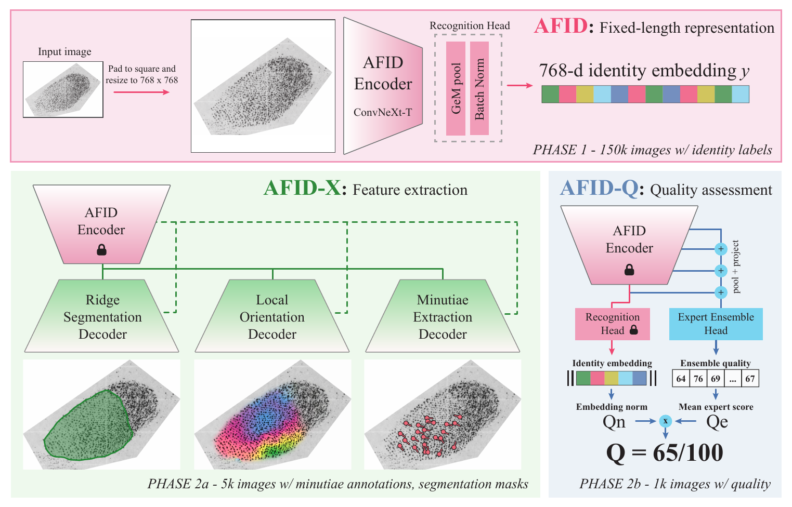

<h1 align="center">AFID: Automated Fingermark IDentification</h1>

<p align="center"><b>A Unified Open Framework for Automated Fingermark Identification, Quality Assessment and Feature Extraction</b></p>

<p align="center">
  <a href="https://arxiv.org/abs/2609.07439"></a>
  
  
  <a href="LICENSE"></a>
  <a href="#weights"></a>
</p>

<p align="center">
  
</p>

AFID is an open framework for processing friction ridge images. It performs fingerprint and fingermark (latent fingerprint) recognition, quality assessment and feature extraction with a single shared encoder, trained only on publicly available data.

- **Recognition.** A fixed-length representation learned for identity discrimination, with essentially no preprocessing beyond resizing and padding.
- **Quality assessment.** A quality module on the same frozen backbone predicts the recognition utility of a fingermark.
- **Feature extraction.** Downstream decoders recover minutiae, ridge orientation and segmentation.

For details and results, see the paper on [arXiv](https://arxiv.org/abs/2609.07439). **The paper is currently under review.**

**Contents:** [Installation](#installation) · [Usage](#usage) · [Weights](#weights) · [Roadmap](#roadmap) · [Status and support](#status-and-support) · [License](#license) · [Related work](#related-work) · [Citation](#citation)

## Installation

AFID needs Python 3.10 or newer.

```bash
pip install -e .
```

The code does not include model weights. Download a release (see [Weights](#weights)) and unzip it into `checkpoints/`.

## Usage

Two short scripts show how to use AFID. They are meant as a demonstration. 

- `demo_extract.py` extracts features and quality scores and saves visualizations.
- `demo_match.py` compares images with each other (1:1, 1:n, n:n, or a list of pairs).

```bash
python demo_extract.py image.png                      # results are saved to results/<name>/
python demo_extract.py folder/ --mode quality --csv q.csv

python demo_match.py a.png b.png                      # 1:1
python demo_match.py probe.png gallery/               # 1:n
python demo_match.py folder/                          # n:n
```

Run either script with `--help` for all options.

In Python:

```python
from afid import load_afid

afid = load_afid()    # uses cuda if available

embedding = afid.embed("fingermark.png")             # identity embedding, float32 [768]
features = afid.extract_features("fingermark.png")   # minutiae, segmentation, orientation
quality = afid.assess_quality("fingermark.png")      # final quality score and its components
results = afid.run("fingermark.png")                 # all of the above in one pass
```

Images can be file paths or numpy arrays. Results are plain dictionaries:

```python
features["minutiae"]       # list of {x, y, theta, quality}
features["segmentation"]   # foreground probability, [H, W]
features["orientation"]    # ridge orientation in degrees (0-180), [H, W]
quality["afid_q"]          # final quality score, integer 0-100
```

Every method also accepts a list of images, which is processed in batches:

```python
embeddings = afid.embed(list_of_images, batch_size=16)    # [N, 768]
```

To compare fingermarks, use the cosine similarity of their embeddings (-1 to 1, higher means more likely the same finger). `similarity` normalizes the embeddings for you:

```python
from afid import similarity

a, b = afid.embed(["a.png", "b.png"])
score = similarity(a, b)                    # float
scores = similarity(embeddings, a)          # [N] scores of one embedding against many
matrix = similarity(embeddings, embeddings) # [N, N], every pair
```

If you only need the embedding, skip loading the other components with `load_afid(afid_x=False, afid_q=False)`.
The docstrings in `afid/pipeline.py` describe all arguments and returned values.

## Weights

The weights are released separately and are not stored in this repository. Each release is a folder named
`<name>_<backbone id>` that contains the model files, the license of those weights and a description of them (`README.txt`).
Unzip it into `checkpoints/`.

| Name | Backbone ID | Input size | Description | License | Link |
|---|---|---|---|---|---|
| `afid_768_noncommercial` | `a19b77afeecd` | 768² | First public release. These are the weights used in the paper. Trained on NIST SD 300, SD 301, SD 302 (subjects 2302-2611), LFIW and IIITD MOLFD. | CC BY-NC 4.0 (research and non-commercial use) | [Download](https://drive.google.com/file/d/1dLKrCmVNnWXHDbWg0GF8GVkkT9ckhKzz/view?usp=sharing) |

`load_afid()` uses the release in `checkpoints/`. If there are several, choose one by its name:

```python
afid = load_afid(release="afid_768_noncommercial")    # demos: --release
```

The folder with the releases can be changed with `checkpoint_dir` (demos: `--checkpoints`).

## Roadmap

- Models trained on a reduced input size, for faster processing.
- Data release: the 1,000 expert quality annotations and the manually annotated segmentation masks for 5,000 NIST SD 302 images.
- Model weights under the Apache 2.0 license, trained on permissively licensed datasets only.

## Status and support

AFID is research code, released as is and without warranty. It is provided to support reproducibility and
further research. We do not promise support, bug fixes or future development, and issues and pull requests
may go unanswered.

## License

The source code is licensed under the [Apache License 2.0](LICENSE).

The model weights are not covered by that license. Each weights release has its own license, listed in the
table above and included as the `LICENSE` file in the release folder.

## Related work

AFID continues our earlier work on automated fingermark quality assessment in [OpenAFQA](https://github.com/timoblak/OpenAFQA), which is now archived.

## Citation

If you find this work useful, please cite:

```bibtex
@article{oblak2026afid,
  title   = {AFID: A Unified Open Framework for Automated Fingermark Identification, Quality Assessment and Feature Extraction},
  author  = {Oblak, Tim and Haraksim, Rudolf and Peer, Peter},
  journal = {arXiv preprint arXiv:2609.07439},
  year    = {2026}
}
```
